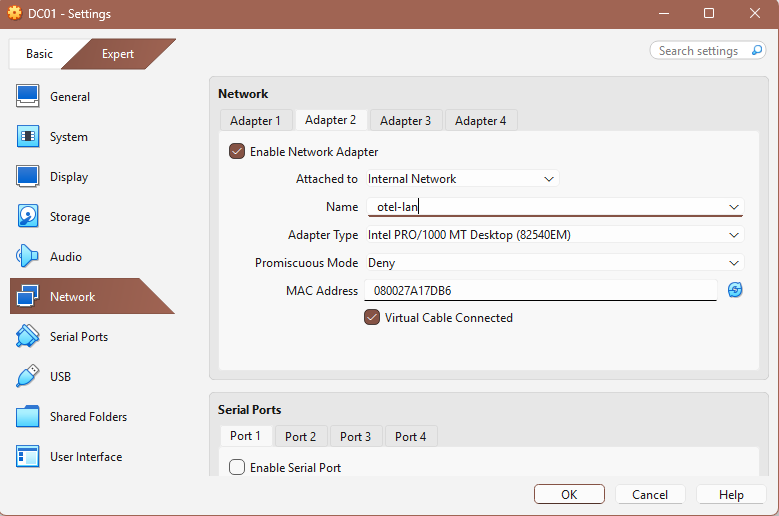
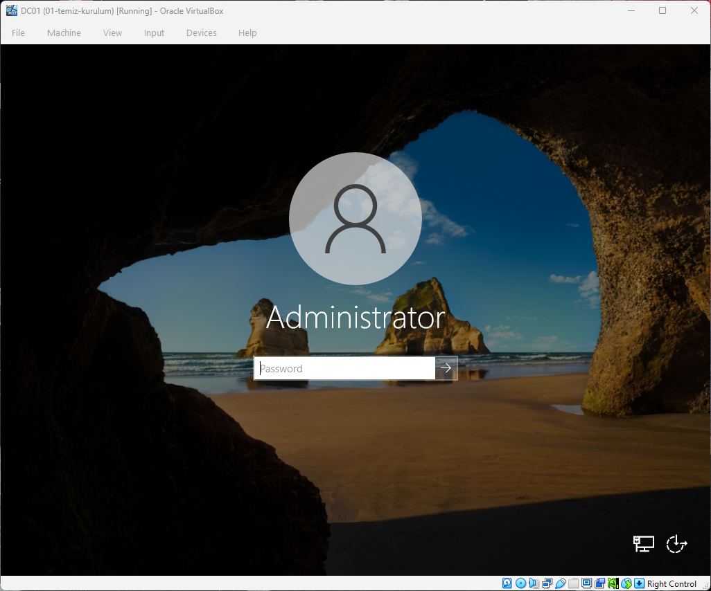
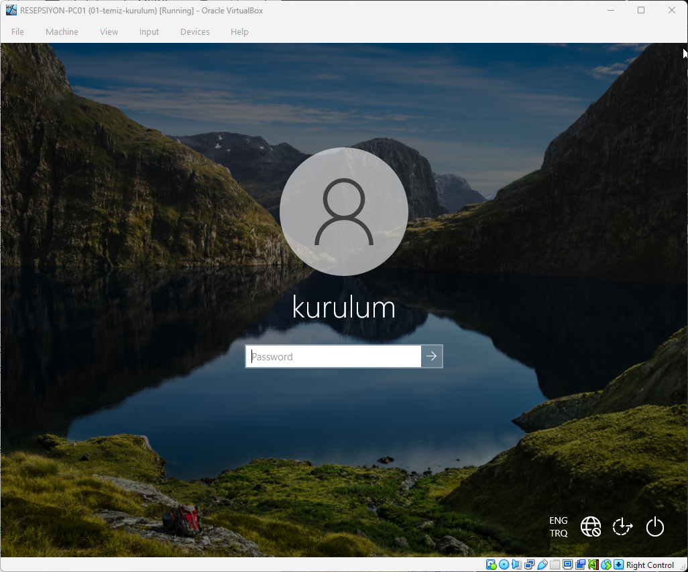

# Lab 0 – Environment Setup

Goal: build an isolated virtual network that behaves like a small hotel office,
where every lab in this repo runs.

## Host
- Windows, 32 GB RAM, hardware virtualization enabled
- Oracle VirtualBox

## Virtual machines
| VM | OS | RAM | CPU | Disk | Network |
|----|----|-----|-----|------|---------|
| DC01 | Windows Server 2022 Standard (Desktop Experience) | 4 GB | 1 | 50 GB | NAT + Internal (`otel-lan`) |
| RESEPSIYON-PC01 | Windows 10 Pro | 3 GB | 1 | 50 GB | Internal (`otel-lan`) only |

## Network design
- **otel-lan** is a VirtualBox *Internal Network*: the VMs can talk to each other
  but are isolated from my home network.
- **DC01** also has a NAT adapter for internet access (updates, downloads).
- **RESEPSIYON-PC01** has no direct internet. Like a real front desk PC, it will
  get its IP, DNS and access through the hotel's server.

## Steps
1. Installed VirtualBox and created both VMs with *Skip Unattended Installation*
   so I could choose the edition manually.
2. Installed Windows Server 2022 with **Desktop Experience** (GUI).
3. Installed VirtualBox Guest Additions on DC01 (display resolution, shared clipboard).
4. Installed Windows 10 **Pro** on the client. Home edition cannot join a domain.
5. Took a clean snapshot of each VM (`01-temiz-kurulum`) so I can roll back
   if a lab breaks something.
6. Installed Cisco Packet Tracer and Wireshark (with Npcap) on the host.

## What I learned
- **Desktop Experience vs Server Core:** Server Core has no GUI, uses fewer
  resources and has a smaller attack surface, so many companies use it for
  domain controllers. I chose Desktop Experience to learn the tools visually first.
- **Windows editions matter:** Windows 10/11 Home cannot join a domain.
  Business PCs need Pro or Enterprise, which is worth checking before buying devices.
- **VirtualBox network modes:**
  - *NAT*: the VM can reach the internet but other machines can't reach it.
  - *Internal Network*: VMs only see each other, fully isolated.
  - *Bridged*: the VM joins my real home network. I avoided it on purpose,
    because the DHCP server I'll install on DC01 would start giving IP
    addresses to devices in my house.
- **Snapshots are not backups:** they make it easy to undo a mistake, but
  they live on the same disk as the VM. Real backups must be stored separately.
- **Npcap:** Wireshark needs this driver to capture packets. I left
  monitor mode and admin-only access off because the labs don't need them.
