# Lab 1 – Active Directory, DNS, DHCP

Goal: build the identity core of the hotel, so every staff member logs in
with one account and gets access based on their department.

> Status: ✅ Done. Part 1: domain, OUs, users, groups. Part 2: DHCP, domain join, file shares, helpdesk tasks.

## Part 1 – Domain and directory structure

### Network setup on DC01
| Adapter | Purpose | IP |
|---------|---------|----|
| NAT-Internet | Internet access | DHCP (10.0.2.15) |
| OTEL-LAN | Hotel internal network | 192.168.10.10/24 (static) |

- Static IP on the internal adapter, because clients must always find the server at the same address.
- DNS points to `127.0.0.1`, since DC01 is its own DNS server.
- *Register this connection's addresses in DNS* is **disabled** on the NAT adapter,
  so clients never receive the unreachable 10.0.2.x address for the domain.
- Time zone set to Istanbul. Kerberos authentication fails if clocks differ by more than 5 minutes.

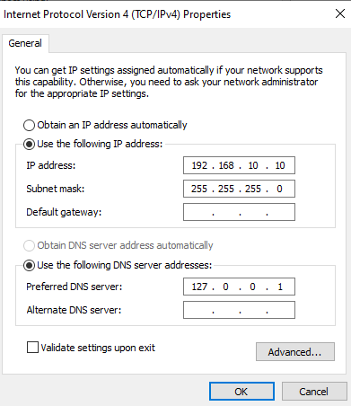

### Domain
- Installed **AD DS, DNS and DHCP** roles.
- Promoted DC01 to the first domain controller of a new forest: `kayaresort.local` (NetBIOS: `KAYARESORT`).

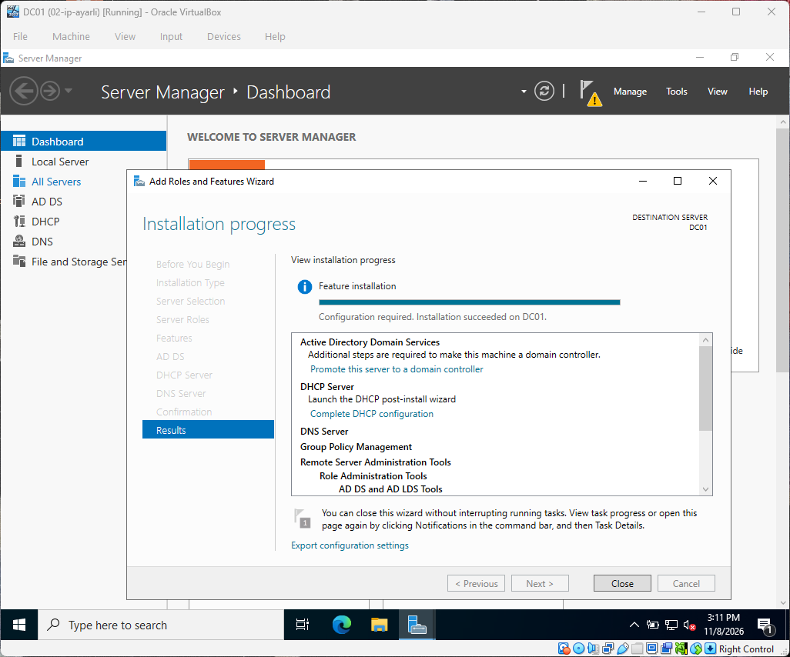
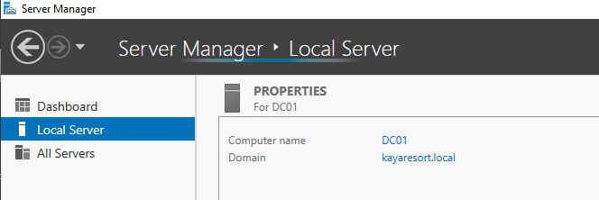

### OU structure
All OUs live under the root OU `KayaResort`.

| OU | Sub-OUs | Purpose |
|----|---------|---------|
| Front Office | Users, Computers | Reception staff and front desk PCs |
| Housekeeping | Users, Computers | Room cleaning staff |
| F&B | Users, Computers | Restaurant and bar staff |
| Accounting | Users, Computers | Finance team, most sensitive data |
| Engineering | Users, Computers | Technical service / maintenance |
| IT | Users, Computers | IT team |
| Seasonal | – | Seasonal staff accounts |
| Disabled | – | Accounts of staff who have left |

Created with [`New-HotelOUStructure.ps1`](scripts/New-HotelOUStructure.ps1).

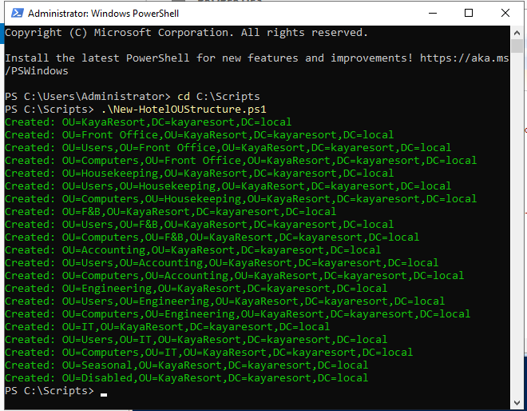
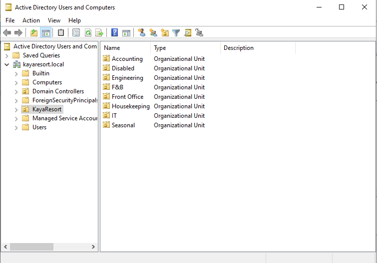

### Groups and users
- One security group per department (`GRP-FrontOffice`, `GRP-FB`, ...) – [`New-HotelGroups.ps1`](scripts/New-HotelGroups.ps1)
- One user created manually to learn the GUI (Ayse Yilmaz, Receptionist).
- 10 staff created from [`staff.csv`](scripts/staff.csv) with [`New-HotelStaff.ps1`](scripts/New-HotelStaff.ps1):
  placed in the right OU, added to the department group, password change forced at first logon.

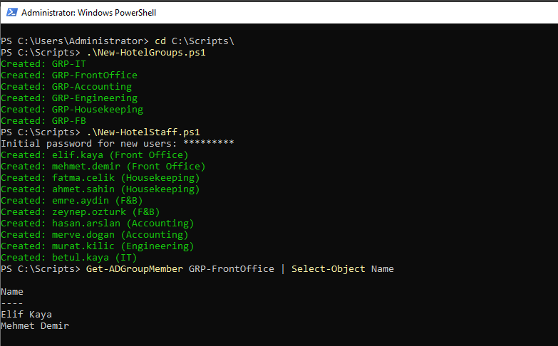

## Part 2 – DHCP, domain join, file shares, helpdesk

### DHCP
| Setting | Value |
|---------|-------|
| Scope | `Hotel-LAN`, 192.168.10.100 – 192.168.10.200 |
| Gateway / DNS | 192.168.10.10 (DC01) |
| DNS domain | `kayaresort.local` |

- Addresses .1–.99 are left out of the scope for devices that need a **fixed IP**:
  servers, printers, key card encoders.
- The DHCP server has to be **authorized in Active Directory** before it hands out any addresses.
  This stops a rogue DHCP server on the network from giving clients wrong settings.

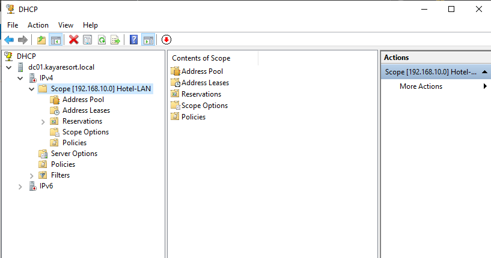
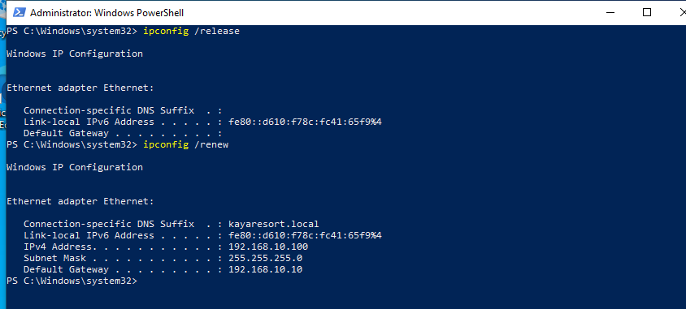

### Joining the front desk PC
1. FRONTDESK-PC01 got its IP from DHCP (`ipconfig /all`) and could resolve `dc01.kayaresort.local`.
2. Renamed it to `FRONTDESK-PC01` and joined `kayaresort.local` with a domain admin account.
3. Moved the computer object from the default `Computers` container to **`Front Office/Computers`**.
   The default container is not an OU, so Group Policy can't be linked to it.
4. Logged in as a receptionist (`KAYARESORT\ayse.yilmaz`) and changed the temporary password at first logon.

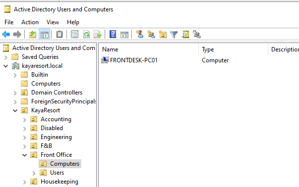
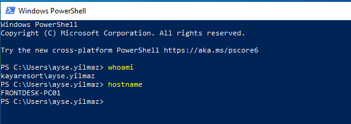

### Department file shares
Created with [`New-HotelShares.ps1`](scripts/New-HotelShares.ps1).

| Layer | Setting | Why |
|-------|---------|-----|
| Share `\\DC01\Shares` | Authenticated Users: Change | Wide at the share level, real control is done with NTFS |
| NTFS on `C:\Shares` | Inheritance removed, users can only list the root | Stops the default "Users can read" permission from `C:` flowing down |
| NTFS on each department folder | Department group: **Modify** | Read, write and delete, but not change permissions |
| Access-Based Enumeration | On | Users only *see* the folders they can open |

**Tested as Ayse (Front Office):**
- `\\DC01\Shares` shows only `FrontOffice`
- Creating a file in `FrontOffice` works
- Typing `\\DC01\Shares\Accounting` directly → *Windows cannot access*

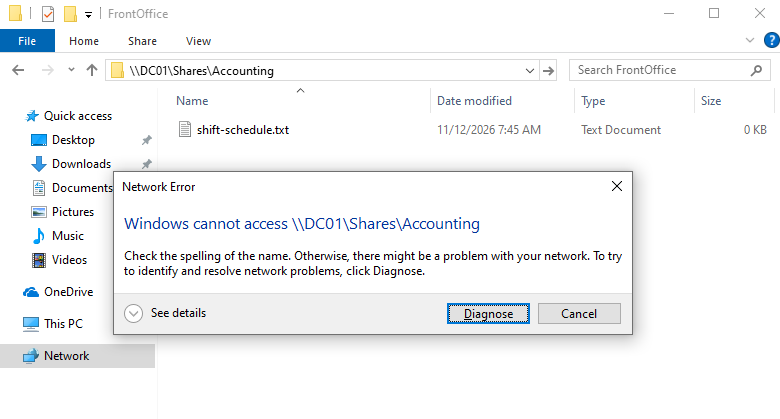

### Helpdesk tasks
- **Account lockout policy:** the default domain policy never locks accounts.
  Set the lockout threshold to 5 failed attempts to slow down password guessing.
- **Password reset:** reset a user's password with *must change at next logon*.
  In real life, verify the caller's identity first: fake reset requests are a common social engineering trick.
- **Account unlock:** locked an account with 5 wrong passwords, found it with
  `Search-ADAccount -LockedOut` and unlocked it.
- **Leaver:** a staff member left. Disabled the account (not deleted), moved it to `Disabled`
  and removed it from the department group.

## Real troubleshooting: "The shared folder is empty"

| | |
|---|---|
| **Symptom** | Ayse opened `\\DC01\Shares` and saw an empty folder. |
| **Checked** | `whoami /groups` on the client showed no `GRP-FrontOffice`. `icacls` on the server showed the permission was correct. |
| **Cause** | I had created Ayse in the `Front Office` OU, but never added her to `GRP-FrontOffice`. Access-Based Enumeration hid every folder from her. |
| **Fix** | Added her to the group, then she signed out and back in to get a new access token. |
| **Lesson** | Being in the right OU decides which policies you get, not what you can access. Group membership is read at logon, so changes need a sign-out. |

## What I learned
- **OU vs group:** the OU decides which policies you get, the group decides what you can access.
- **DNS is everything in AD:** clients find the domain controller through DNS, so a domain join fails without it.
- **DHCP must be authorized in AD** before it hands out addresses. A `169.254.x.x` address means the client never reached it.
- **Share + NTFS permissions:** both apply and the stricter one wins. Keep the share open, control access with NTFS.
- **Disable, don't delete** accounts of staff who leave.
